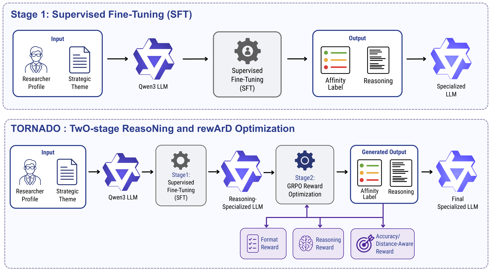
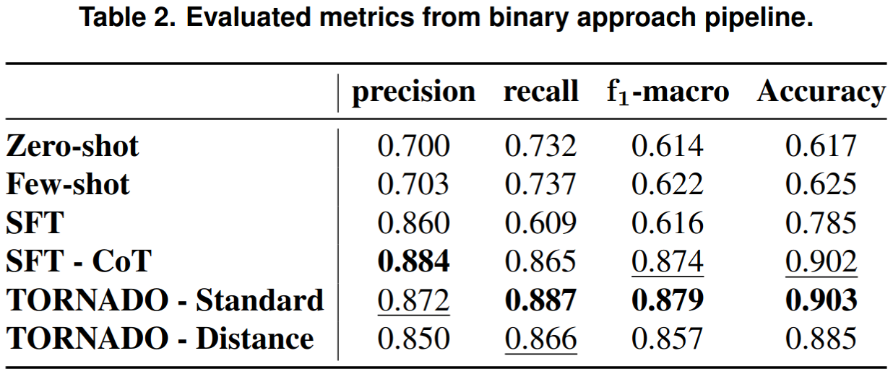
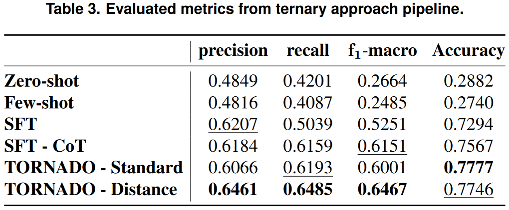

# Mapping Researchers to Strategic Themes with Language Models via Reasoning- and Reward-Guided Fine-Tuning

- Augusto Cesar Dalal Miranda (FACOM/UFMS) | augusto.dalal@ufms.br
- Marcos Paulo Silva Gôlo (ICMC/USP) | marcosgolo@usp.br
- Marcela Aparecida Aniceto dos Santos (ICMC/USP) | marcelaaniceto@gmail.com
- Ricardo Marcondes Marcacini (ICMC/USP) | ricardo.marcacini@usp.br
- Marcelo Augusto Santos Turine (FACOM/UFMS) | marcelo.turine@ufms.br
- Mariana Caravanti de Souza (FACOM/UFMS) | mariana.caravanti@usp.br 

# Abstract

Mapping researcher profiles to strategic topics is a key challenge in the Brazilian National Graduate System (SNPG), as it supports public policy planning and research funding allocation. To address this problem, this paper proposes TORNADO, a TwO-stage ReasoNing–rewArD Optimization method that combines reasoning supervision and reward optimization. Its main contribution is a distance-aware reward that models the ordinal structure of affinity labels by penalizing severe errors more than adjacent-class mistakes. Experiments on the LeanDL-HPC dataset show that TORNADO outperforms zero-shot, few-shot, and conventional supervised fine-tuning baselines, providing an efficient and scalable alternative for strategic decision-making within the SNPG.


# Original Datasets (LeanDL-HPC 2025 Challenge)

The original datasets can be downloaded using `gdown` with the command below:
```bash
gdown 1-QXkqH8HzLcV2JCA4Nm9G5rQhorYKJVe
```

Details about the LeanDL-HPC 2025 challenge are available at the following links:

- [LeanDL-HPC 2025 Workshop](https://sites.labic.icmc.usp.br/leandl2025/)
- [Google Collab Notebook - About the LeanDL-HPC 2025 Workshop](https://colab.research.google.com/drive/1bJUCxDJ4Cmd2VLQp1-Wx2r_vSkYQUezT?usp=sharing#scrollTo=nph7MnuufZWQ)

# Pipeline Comparison: SFT vs TORNADO

 

# Results

## Metrics From Binary Approach 

 

## Metrics From Ternary Approach 

 

# Setup and Requirements

Due to the distinct libraries required for different stages of the pipeline, the dependencies have been split into three separate files. **It is mandatory to use separate virtual environments (`.venv`) for each of them** to avoid package conflicts:

- `requirements_inference.txt`: Packages required to run model inferences.
- `requirements_train_sft_definitive.txt`: Packages required for Supervised Fine-Tuning (SFT) training.
- `requirements_train_grpo_definitive.txt`: Packages required for GRPO training.

# Models

> **Note:** The generated models (`/models` directory) are not included in this repository due to their large file sizes.
> 

# Files Organization

> **Important:** The `outputs/` directory contains legacy/deprecated data. Please consider **only** the `consolidated_outputs/` directory for the definitive results, metrics, and plots.

- **`consolidated_outputs/`**: **(Definitive)** Contains the final evaluated metrics, predictions, and plots for all Qwen models (Base, Few-Shot, SFT, SFT-CoT, GRPO Standard, GRPO Distance) across 2-class and 3-class tasks.
  - `confusion_matrix_default_labeled/`: Final confusion matrices (CSVs and PNG plots).
  - `results_default_labeled/`: Final metric JSONs and test prediction parquet files.
  - `results_old/`: Previous iteration logs and resource statistics.
  - `recalc_metrics_matrix.py` / `set_default_label.py`: Scripts used to process and standardize these final outputs.
- **`outputs/`**: *(Deprecated)* Old outputs, plots, and matrices. Replaced by `consolidated_outputs`.
- **`data/`**: Raw (original) and processed datasets, along with the preprocessing scripts for 2-class and 3-class classifications.
- **`src/`**: Main source code directory.
  - `evaluation/`: Scripts for calculating metrics.
  - `inference/`: Scripts for the inference engine.
  - `training/`: Training modules for SFT and GRPO (`sft_trainer.py`, `grpo_trainer.py`).
  - `utils/`: Auxiliary scripts for configuration, logging, and hardware resource monitoring.
- **`notebooks/`**: Jupyter notebooks for data analysis, matrix visualization, and troubleshooting (`confusion_matrix.ipynb`, `fix_problems.ipynb`).
- **`config.yaml`**: Main configuration file for the pipelines.
- **`main.py`**: Entry point to execute the experiments.
- **`emissions.csv`**: Carbon emission logs generated during the execution of the pipelines.

# References

[1] Al Faraby, S., Romadhony, A., and Adiwijaya (2024). Analysis of llms for educational question classification and generation. Computers and Education: Artificial Intelligence, 7:100298.

[2] CAPES (2023). Plano nacional de pós-graduação – PNPG 2024–2028: versão preliminar para consulta pública. Technical report, Ministério da Educação / CAPES, Brasília.

[3] Chang, Y., Wang, X., Wang, J., Wu, Y., Yang, L., Zhu, K., Chen, H., Yi, X., Wang, C., Wang, Y., et al. (2024). A survey on evaluation of large language models. ACM transactions on intelligent systems and technology, 15(3):1–45.

[4] Gôlo, M. P. S. and Utino, M. Y. R. (2025). One-class lightweight interpretable filtering for academic profiles and strategic themes affinity. In International Symposium on Computer Architecture and High Performance Computing Workshops, pages 147–154.

[5] Guo, D., Yang, D., Zhang, H., Song, J., Zhang, R., Xu, R., Zhu, Q., Ma, S., Wang, P., Bi, X., et al. (2025). Deepseek-r1: Incentivizing reasoning capability in llms via reinforcement learning. arXiv preprint arXiv:2501.12948.

[6] Liu, X., Zheng, Y., Du, Z., Ding, M., Qian, Y., Yang, Z., and Tang, J. (2023). Gpt understands, too. AI Open.

[7] Matsubura, E. T., Borin, E., Cirne, W., Cáceres, E. N., Marcacini, R., Nogueira, B., Silva, D. F., de Andrade Silva, J., Turine, M. A. S., de Souza, M. C., et al., editors (2025). Workshop on Lightweight and Efficient Deep Learning in HPC Environments.

[8] Miranda, A. C. D., Utino, M. Y. R., Gôlo, M. P. S., Dos Santos, M. A. A., and de Souza, M. C. (2025). Reducing costs in large-scale classification: A hybrid bert–llm strategy. In International Symposium on Computer Architecture and High Performance Computing Workshops, pages 131–138.

[9] Mustafa, A., Naseem, U., and Rahimi Azghadi, M. (2026). Can reasoning llms enhance clinical document classification? Health and Technology, 16.

[10] Sakai, H. and Lam, S. S. (2026). Large language models for health care text classification: Systematic review. JMIR AI, 5:e79202.

[11] Sakiyama, K. M., Fujimoto, M. L., Santin, R. V., and Rezende, S. O. (2025). Leandl hpc challenge 2025: Applying large-scale model adaptation techniques. In International Symposium on Computer Architecture and High Performance Computing Workshops, pages 139–146.

[12] Shao, Z., Wang, P., Zhu, Q., Xu, R., Song, J., Bi, X., Zhang, H., Zhang, M., Li, Y., et al. (2024). Deepseekmath: Pushing the limits of mathematical reasoning in open language models. arXiv preprint arXiv:2402.03300.

[13] Turine, M. A. S., Souto Maior, A. P., and Marcacini, R. M. (2025). National agenda for the training of higher-level personnel. Technical Report 1, CAPES – Coordination for the Improvement of Higher Education Personnel, Ministry of Education, Brazil.

[14] United Nations (2015). Transforming our world: The 2030 agenda for sustainable development. Technical report, United Nations. Accessed: Apr. 20, 2026.

[15] Utino, M. Y. R. and Gôlo, M. P. S. (2025). Efficient filtering with bert embeddings for researcher–topic affinity prediction in hpc pipelines. In International Symposium on Computer Architecture and High Performance Computing Workshops, pages 155–162.

[16] Wei, J., Wang, X., Schuurmans, D., Bosma, M., Xia, F., Chi, E., Le, Q. V., Zhou, D., et al. (2022). Chain-of-thought prompting elicits reasoning in large language models. Advances in neural information processing systems, 35:24824–24837.
